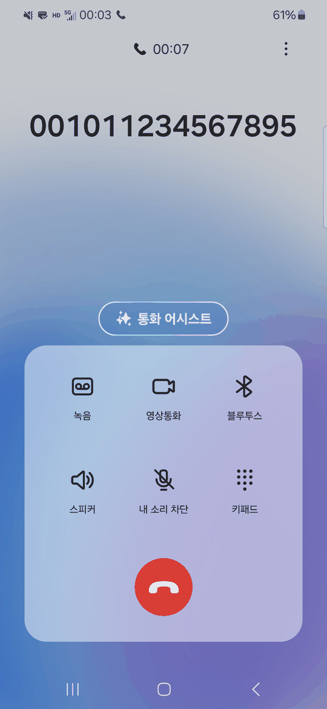
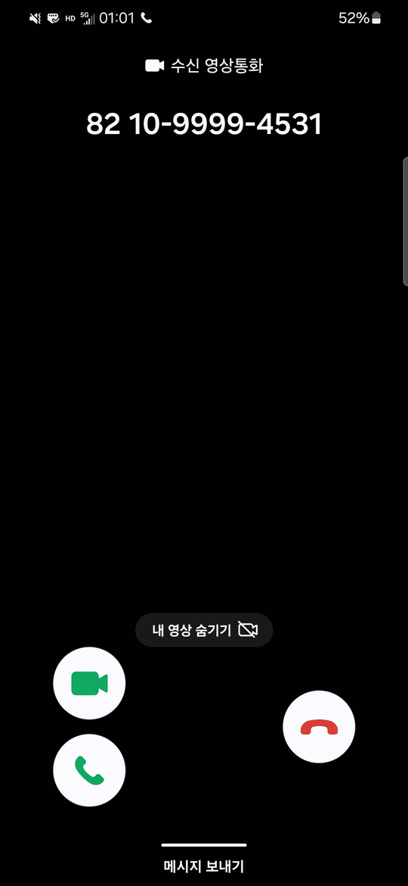
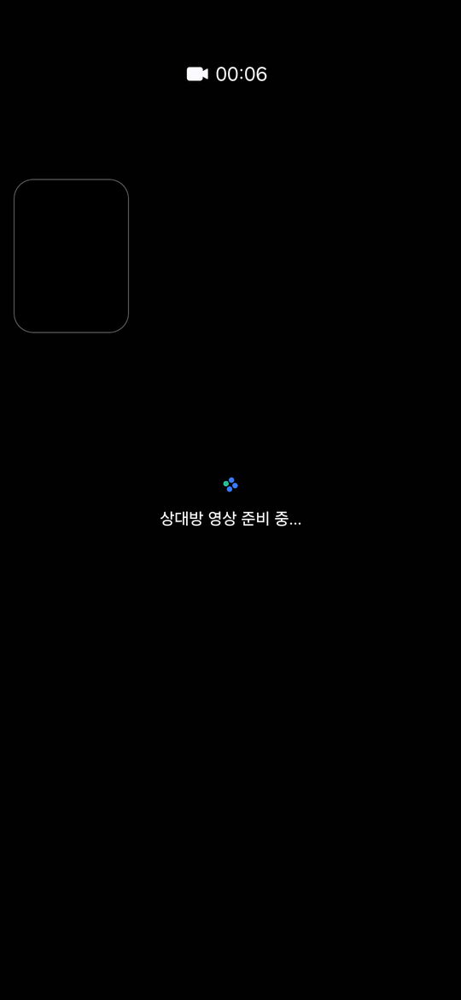
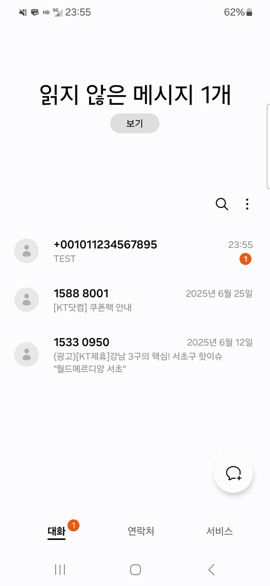
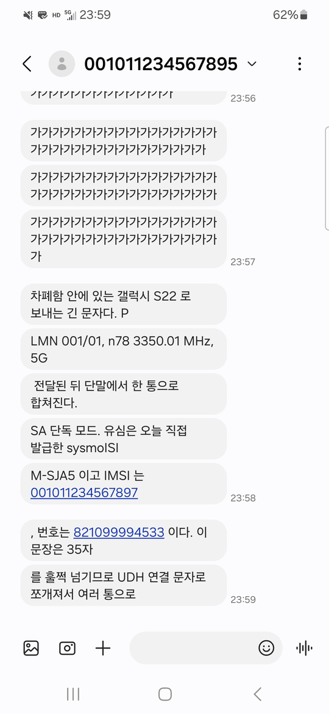
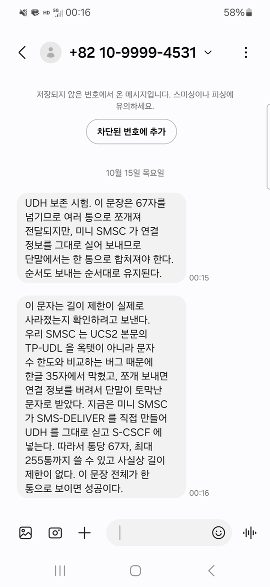
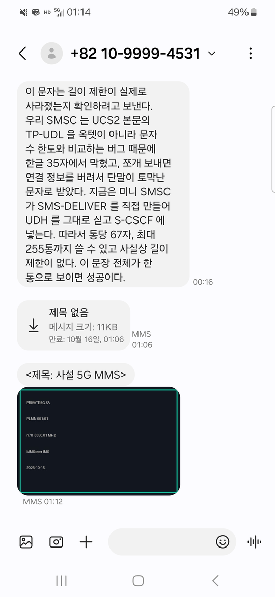

# 13. 음성과 문자: SIP 를 아는 사람을 위한 IMS

## 13.1 이미 아는 것에서 출발한다

VoIP 를 한 번이라도 다뤄 봤다면 SIP 를 안다. 다뤄 본 적이 없어도 와이어샤크에서 `sip` 필터를 걸면 HTTP 와 거의 같은 텍스트 요청·응답이라 금방 읽힌다. REGISTER 로 "나 여기 있다"를 알린다. INVITE 는 통화를 거는 요청이다. HTTP 의 POST 처럼 본문을 싣는데, 그 본문이 SDP(Session Description Protocol)로 "나는 이 IP 의 이 UDP 포트로 이 코덱을 받겠다"는 몇 줄짜리 텍스트다. 실제 음성은 SIP 가 아니라 RTP(Real-time Transport Protocol)라는 UDP 패킷 흐름으로 따로 가고, 와이어샤크의 `rtp` 필터에 잡히는 것이 그것이다. BYE 는 통화를 끊는 요청이다. 프록시가 중간에서 Via 와 Record-Route 를 쌓는다. 이것을 알면 IMS 의 **8 할은 이미 아는 것**이다. IMS 는 SIP 에 통신사의 요구 다섯 가지를 얹은 것이고, 그 다섯 가지가 새로 배울 전부다.

| 독자가 아는 것 (SIP/VoIP) | IMS 에서의 이름 |
|---|---|
| outbound proxy (단말이 처음 말을 거는 프록시) | **P-CSCF** |
| registrar + 호 라우터 | **S-CSCF** |
| "이 사용자는 어느 registrar 가 맡나" 조회 | **I-CSCF** + HSS 의 LIR |
| 사용자 DB (Asterisk 의 sip.conf, Kamailio 의 subscriber 테이블) | **HSS** (우리는 PyHSS) |
| HTTP Digest 인증 | **AKAv1-MD5** (10 장의 MILENAGE 를 Digest 에 담은 것) |
| 미디어 릴레이 (rtpproxy, TURN) | **rtpengine** |
| DNS SRV(서비스별 호스트·포트 레코드)/NAPTR(이름을 규칙으로 다시 쓰는 레코드)로 다음 홉 찾기 | IMS 도메인 `ims.mnc001.mcc001.3gppnetwork.org` 해석 |
| SIP MESSAGE(본문에 글을 실어 보내는 SIP 요청, RFC 3428)로 인스턴트 메시지 | **SMS over IMS** (본문이 3GPP SMS 바이트) |

새로 배울 다섯 가지는 이것이다. 첫째, **전화번호(E.164)로 걸고 다른 사업자에게도 걸린다** — 그래서 `tel:` URI 와 I-CSCF 가 있다. 둘째, **품질을 보장한다** — 그래서 P-CSCF 가 코어의 PCF 에 "이 통화에 음성 베어러를 열어라"고 요청하는 N5 가 있고, 11 장의 5QI 가 여기서 쓰인다. 셋째, **인증은 SIM 으로** — 그래서 HTTP Digest 안에 MILENAGE 가 들어간다. 넷째, **단말의 IP 와 코어의 세션이 묶여 있어야 한다** — 그래서 P-CSCF 가 소스 IP 로 PDU 세션을 확인한다. 다섯째, **문자는 1990 년대 SMS 바이트를 그대로 SIP 에 싼다.**

이 장은 우리 실험에서 통화와 문자가 성립하기까지 **차례로 만난 벽 일곱 개**를 그대로 따라가고, 실물 단말을 붙이며 만난 둘(⑧ 영상·⑨ MMS)을 13.6a·13.7a 에서 더한다. 13.9 의 표가 아홉 개를 한자리에 모은다. 벽마다 "왜 막혔는가"가 곧 "IMS 는 왜 이렇게 생겼는가"다.

## 13.2 왜 전화를 IP 위에 다시 세워야 했나

2G 와 3G 는 **회선 교환**이었다. 전화를 걸면 망이 음성 전용 경로를 통째로 잡아 줬다. 4G 는 **All-IP** 다. 음성 전용 경로가 없다. 그러면 전화는 "IP 패킷으로 음성을 보내는 앱"이 되어야 한다. 그런데 그냥 VoIP 앱으로 끝낼 수 없는 이유가 있었다.

스카이프 같은 VoIP 는 아이디로 걸고, 같은 앱끼리만 통하고, 품질은 되는 대로이고, 긴급통화가 안 되고, 계정은 앱 서버가 관리한다. 통신사 전화는 **전화번호**로 걸어야 하고, **다른 사업자 가입자**에게도 걸려야 하고, **끊기지 않아야** 하고, **112 가 되어야** 하고, **SIM 으로 인증하고 과금**해야 한다. 이 요구를 전부 만족하는 표준 VoIP 플랫폼을 3GPP 가 2000 년대 초(Release 5)에 정했고, 그것이 **IMS(IP Multimedia Subsystem)** 다. SIP 를 그대로 가져다 쓰고 위의 요구를 헤더와 절차로 얹었다. 5G 에서 IMS 로 하는 전화를 **VoNR**, 4G 에서는 **VoLTE** 라 하는데, 코어만 다르고 IMS 는 같다.

## 13.3 IMS 의 조각: 프록시 셋과 DB 하나

프록시가 왜 **세 개**인지부터 말하면 나머지가 쉽다. 웹 서비스 앞단을 생각하면 똑같은 세 겹이 있다. 바깥과 맞닿아 TLS 를 끊고 레이트 리밋을 거는 **엣지 프록시**, 요청을 보고 어느 백엔드로 보낼지 정하는 **라우터**, 그리고 그 사용자의 세션과 규칙을 실제로 들고 처리하는 **애플리케이션 서버**. IMS 의 P·I·S 가 각각 그 자리다. **P**-CSCF 가 엣지(단말이 유일하게 직접 말하는 상대), **I**-CSCF 가 라우터(이 번호를 누가 맡나 DB 에 물어본다), **S**-CSCF 가 애플리케이션 서버(가입자별 규칙 iFC 를 들고 있다)다. 한 덩어리로 만들지 않은 이유도 웹과 같다 — 바깥에 노출되는 것과 가입자 데이터를 쥔 것을 **같은 프로세스에 두지 않는다.**

```
                        [HSS / PyHSS]  ← 가입자 DB + 인증 벡터 (Diameter Cx)
                          ▲        ▲
                     UAR  │        │  MAR, SAR, LIR
 [단말] ──SIP──▶ [P-CSCF] ──▶ [I-CSCF] ──▶ [S-CSCF] ──▶ (착신 S-CSCF → P-CSCF → 단말)
                    │                           │
                    │ N5 (4G 의 Rx 자리)        │ ISC (iFC 가 시키는 대로)
                    ▼                           ▼
                  [PCF]                 [응용서버: SMSC …]
```

**P-CSCF(Proxy-CSCF)** 는 단말이 처음 만나는 프록시다. 단말이 바깥으로 나갈 때 무조건 거쳐 가도록 지정해 둔 **아웃바운드 프록시**(사내망에서 모든 HTTP 를 한 프록시로 몰아 내보내는 그 구조)에, **세션 보더 컨트롤러**(사업자 경계에 세우는 SIP 전용 방화벽 겸 NAT. 줄여서 SBC)의 역할이 더해졌다. 단말의 IP 가 코어의 어느 세션인지 확인하고(N5), 미디어 릴레이(rtpengine)를 붙이고, 통화마다 코어에 QoS 를 요청한다. **I-CSCF(Interrogating-CSCF)** 는 망의 입구다. 등록 때는 "이 가입자를 어느 S-CSCF 가 맡을까", 착신 때는 "이 번호의 S-CSCF 는 어디인가"를 HSS 에 묻는다. 로드밸런서 겸 디렉터리 조회다. **S-CSCF(Serving-CSCF)** 가 registrar 이자 호 제어의 중심이다. 인증하고, 등록 상태를 보관하고, 가입자의 서비스 규칙(iFC)에 따라 응용서버로 분기하고, 착신을 라우팅한다. **HSS** 는 IMS 가입자 DB 이고 인증 벡터를 만든다. 5G 코어의 UDM 과는 **별개**다. 4G 유산이기 때문이다.

CSCF 는 Call Session Control Function 이다. 셋 다 오픈소스 SIP 서버 Kamailio 에 각각 다른 설정을 올린 것이고, 우리 컨테이너 `pcscf`·`icscf`·`scscf` 가 그것이다. 한 대로 합쳐도 돌아간다. 셋으로 나눈 것은 "단말 쪽 경계(보안·QoS)", "망 입구(어디로)", "가입자 서비스(등록·라우팅)"로 **책임을 가른 것**이고, 상용망에서 수백만 가입자를 수십 대의 S-CSCF 가 나눠 맡으려면 I-CSCF 가 필요하다.

가입자 DB 가 **둘**이라는 점을 다시 짚는다. mongo 는 5G 등록과 세션용으로 Ki, DNN, 5QI, PCC 규칙을 가진다. mysql(PyHSS) 은 IMS 등록과 통화용으로 **같은 Ki** 를 따로 또 가지고, MSISDN, iFC, S-CSCF 할당을 가진다. 그래서 우리는 가입자를 **양쪽에** 넣었고, 10 장에서 말한 SQN 재동기가 생길 수 있다. 상용망은 UDM 이 HSS 를 흡수하거나 둘을 동기화한다.

## 13.4 등록: REGISTER 한 번에 조각 넷이 움직인다

통화 전에 **IMS 등록**이 있어야 한다. 9 장의 5G 등록과는 별개다. "나 여기 있다, 이 IP 이 포트로 불러라"를 IMS 에 알리는 것이다. 흐름은 독자가 아는 SIP 등록에 HSS 조회와 QoS 확인이 끼어든 것이다.

단말이 REGISTER 를 P-CSCF 에 보낸다. P-CSCF 는 받자마자 **N5** 로 PCF 에 묻는다. "이 소스 IP 의 PDU 세션이 있고, IMS 시그널링을 실을 QoS(5QI 5)인가?" 통과하면 I-CSCF 로 넘기고, I-CSCF 는 HSS 에 **UAR** 로 "이 가입자 등록 가능한가, S-CSCF 는 누구인가"를 묻고(응답 UAA), S-CSCF 로 넘긴다. S-CSCF 는 HSS 에 **MAR** 로 인증 벡터를 받고(MAA: RAND, AUTN, XRES, CK, IK), 단말에 **401** 을 돌려준다. `nonce` 에 RAND‖AUTN 이 들어 있다. P-CSCF 는 그 401 에서 `ck=`, `ik=` 를 **떼고** 단말에 전달한다. 단말은 10 장의 MILENAGE 를 돌려 RES 를 얻고, Digest 응답을 넣은 REGISTER 를 다시 보낸다. S-CSCF 가 RES 를 검증하고, HSS 에 **SAR** 로 "등록됐다, 이 가입자의 서비스 규칙을 줘"라고 하면(SAA: iFC XML), 단말에 **200 OK** 를 보낸다. 그리고 iFC 가 시키는 응용서버들에 "이 가입자 등록됐다"는 3rd-party REGISTER 를 보낸다.

우리가 받은 200 OK 의 두 헤더가 이 흐름의 결과다.

```
P-Associated-URI: <sip:821099994531@ims.mnc001.mcc001.3gppnetwork.org>, <tel:821099994531>, <sip:001011234567895@…>
Service-Route: <sip:orig@scscf.ims.mnc001.mcc001.3gppnetwork.org:6060;lr>
```

**P-Associated-URI** 는 "당신은 이 세 이름으로 불린다"다. 전화번호 형식의 sip 주소, `tel:` 주소, 그리고 IMSI 형식의 sip 주소. HSS 의 `ims_subscriber.msisdn` 이 `tel:` 로 돌아온 것이고, **전화번호가 IMS 에 반영됐다**는 증거다. **Service-Route** 는 "앞으로 발신 요청은 이 S-CSCF 를 거쳐라"다. 이후 INVITE 의 Route 헤더에 넣는 값이다.

IMS 의 신원 용어를 정리한다. **IMPI(IMS Private Identity)** 는 인증용 비공개 ID 로 로그인 ID 에 해당한다. 우리는 `001011234567895@ims.mnc001.mcc001.3gppnetwork.org` 다. **IMPU(IMS Public Identity)** 는 남이 부르는 공개 ID 로 이메일 주소나 전화번호에 해당하고 여러 개 가질 수 있다. **realm(홈 도메인)** 은 IMS 망의 이름이다. 7 에서 ISIM 이 비어 있어 IMPI 를 IMSI 에서 유도했다고 했는데, 그 규칙이 `IMSI@ims.mnc<MNC>.mcc<MCC>.3gppnetwork.org` 다. 이 `3gppnetwork.org` 도메인은 인터넷으로 나가지 않는다. 우리 `dns` 컨테이너가 푼다.

**벽 ①: `412 Register N5 QoS authorization failed`.** P-CSCF 의 첫 확인에서 두 번 걸렸다. 처음 호스트 브리지 IP(172.22.0.1)로 보냈을 때는 그 IP 에 **PDU 세션이 없어서**, 단말 IP(10.45.0.x)로 바꾼 뒤에는 세션은 있지만 **5QI 9 라서** 거절됐다. PCF 로그가 `Even the Default Bearer(QCI:9,ARP:8) cannot support IMS signalling` 이라고 정확히 말해 줬다. 11 장의 5QI 가 등록 첫 관문에서 바로 쓰인다. **IMS 등록은 반드시 단말의 PDU 세션 IP 에서, 5QI 5 를 실을 수 있는 세션으로** 보내야 한다. 상용 단말은 `ims` DNN 세션으로 보내므로 자동으로 만족한다. 우리 모뎀 펌웨어가 IMS 를 지원하지 않아 `internet` 세션의 등급을 5 로 올린 것은 실험실 고유의 우회였다.

실물 단말을 붙이면 이 구분이 바로 걸린다. 단말은 **번호 기반 IMPU**(`sip:821099994533@<realm>`)로 등록하고 그 번호로만 걸린다. 우리 도구가 IMSI 형식으로 걸었을 때 I-CSCF 가 500 을 돌려준 것이 그 때문이다(사례 23). **등록이 됐다는 것은 그 신원으로 걸 수 있다는 뜻이 아니다.**

## 13.5 통화: INVITE 한 번이 몇 바퀴를 도는가

등록된 A(모뎀 쪽)가 B(nr-UE 쪽)에게 건다. 독자가 아는 SIP 통화에 홉이 많이 끼어든 것인데, 그 홉 하나하나가 통신사의 요구 하나씩이다.

A 가 INVITE 를 P-CSCF 에 보낸다. SDP 에 자기 오디오 포트가 있다. P-CSCF 는 두 가지를 한다. **N5** 로 PCF 에 "이 통화의 미디어 QoS 를 허가해라"를 요청하고, **rtpengine** 에 "중계 포트를 열어라"고 해서 SDP 의 IP 와 포트를 rtpengine 것으로 **바꿔 쓴다.** 그리고 S-CSCF(A) 로 넘긴다. S-CSCF(A) 는 발신 처리를 한다. iFC 를 검사하고, 착신 번호를 정규화하고, 착신 도메인이 우리 망이니 I-CSCF 로 보낸다. I-CSCF 는 HSS 에 **LIR** 로 "B 의 S-CSCF 는 어디인가"를 묻고(LIA 에 S-CSCF 주소), 그쪽으로 넘긴다. S-CSCF(B) 는 착신 처리를 한다. B 의 등록된 Contact 주소를 꺼내고, 등록 때 저장된 경로(Path 헤더)로 P-CSCF(B) 에 보낸다. P-CSCF(B) 도 rtpengine 과 N5 를 거쳐 B 의 Contact 주소로 INVITE 를 보낸다. B 가 180 Ringing 과 200 OK 를 역순으로 돌려보내고, A 가 ACK 를 Route set 을 따라 보내면 통화가 성립한다. RTP 는 A ↔ rtpengine ↔ B 로 흐르고, BYE 로 끊으면 양쪽 P-CSCF 가 N5 로 QoS 를 해제한다.

한 통화에 SIP 요청 셋(INVITE, ACK, BYE)과 응답 여러 개가 **홉마다** 오간다. 우리 캡처에서 I-CSCF 와 S-CSCF 사이에만 UDP 패킷이 십여 개였던 이유다. 이제 우리가 만난 벽들이다.

**벽 ②: `500 Server error on LIR select next S-CSCF`.** 이 문구는 "LIR 이 실패했다"처럼 읽힌다. 아니었다. I-CSCF 설정을 열어 보니 이 문장은 `failure_route` 안, 즉 **다음 홉이 408 타임아웃을 냈을 때 들어오는 블록**에 있었다. 캡처에서 LIA 에는 S-CSCF 주소가 정상적으로 들어 있었다. 그러니까 LIR 은 성공했고, I-CSCF 가 S-CSCF 로 INVITE 를 넘긴 뒤 **그 뒤 어딘가**에서 응답이 없어 408 이 났고, 대체 S-CSCF 가 없어 500 으로 포장된 것이다. Kamailio 의 오류 문구는 **그 코드가 놓인 자리의 이름**이지 원인이 아니다. 원인은 다음 홉에 있었다.

**벽 ③: P-CSCF 가 단말에 TCP 로 보낸다.** 착신 P-CSCF 로그가 답이었다. `connect 10.46.0.7:5062 failed`, 그 위에 `tcp_main.c`. 우리 단말 쪽 소프트웨어는 UDP 만 듣고 있었는데 P-CSCF 는 TCP 로 연결하려 했다. 왜 TCP 인가. 캡처로 홉마다 크기를 재 보니 INVITE 는 P-CSCF 를 떠날 때 1220 바이트였다가 S-CSCF 를 지나 **1317**, I-CSCF 를 지나 1465, 착신 S-CSCF 를 지나 P-CSCF(B)에 도착할 때 **1636 바이트**였다(13.8a 의 표. 한 프레임에 못 들어가 IP 조각 두 개로 쪼개져 도착했다). RFC 3261 §18.1.1 은 요청이 경로 MTU 에서 200 을 뺀 크기를 넘거나, MTU 를 모를 때 1300 바이트를 넘으면 **TCP 처럼 혼잡 제어가 있는 전송으로 보내라**고 정한다. IMS 는 홉마다 Via, Record-Route, P-헤더가 붙어서 INVITE 가 금방 커진다. 그래서 **IMS 단말은 TCP 를 반드시 들어야 한다.** 우리 도구에 TCP listener 를 넣자 INVITE 가 도착했다. Contact 에 `;transport=udp` 를 넣어 UDP 를 강제하는 것도 시도했는데 **역효과**였다. P-CSCF 가 Contact 의 `alias=` 파라미터로 단말 주소를 파싱하는데 `transport=` 가 끼자 파싱이 깨져 `IP is <null>` 이 됐다. 표준만 믿고 프록시의 구현을 모르면 생기는 일이다.

**벽 ④: `404 Not here` 와 단방향 RTP.** INVITE 가 통했는데 BYE 에 404 가 오고 발신 쪽 RTP 수신이 0 이었다. 둘 다 **우리 도구가 다이얼로그 안의 요청(ACK, BYE)을 잘못 만든** 버그였다. RFC 3261 §12.1.2 는 UAC(User Agent Client, 요청을 보내는 쪽의 SIP 단말)가 2xx 응답의 **Record-Route 를 Route 로 바꿔** 그 순서대로 넣고, Request-URI 는 **2xx 의 Contact(remote target)** 로 하라고 한다. 우리 도구는 Record-Route 를 이름 그대로 넣고 Request-URI 에 원래 호출 URI 를 썼다. 프록시는 그런 요청의 다이얼로그를 못 찾는다(404). ACK 가 B 에 안 닿으니 rtpengine 이 역방향을 열지 않아 RTP 가 한쪽만 흘렀다. 고친 뒤 ACK 도착, RTP 양방향 200/200, BYE 200 OK 가 됐다. SIP 를 아는 독자라면 "그걸 왜 틀려" 하겠지만, 실험용 도구를 급하게 짤 때 가장 자주 빠지는 구멍이다.

**벽 ⑤: `488 N5 QoS authorization failed for call`.** INVITE 가 통하자 P-CSCF 가 **통화 미디어용 QoS** 를 PCF 에 요청했고, PCF 가 `No PCC Rule in DB [QoS Index:1]` 로 거절했다. 11 장의 5QI 1 PCC 규칙을 양쪽 가입자에 넣자 통과했다. 영상은 같은 방식으로 5QI 2 다. 이 벽이 **IMS 와 코어가 연결되어 있다**는 가장 직접적인 증거다. SIP 통화가 성립하려면 PCF 가 음성 베어러를 열어 줘야 하고, 그 근거는 가입자 DB 의 PCC 규칙이다. 일반 VoIP 에는 없는 단계다.

## 13.6 미디어: rtpengine 이 사이에 있는 이유

SDP 를 보면 A 의 오디오 포트는 `10.45.0.6:40000` 이었는데 B 가 받은 SDP 는 `172.22.0.16:49288` 이었다. `172.22.0.16` 은 rtpengine 이다. 양쪽 P-CSCF 가 SDP 를 바꿔치기해서 RTP 가 단말끼리 직접 가지 않고 **rtpengine 을 거친다.** 독자가 아는 rtpproxy 나 TURN 과 같은 자리다.

왜 중계하는가. 두 단말이 서로 다른 DNN(10.45 와 10.46)에 있어서 직접 라우팅이 보장되지 않는다는 것이 첫째다. 중계점은 양쪽에서 닿는다. 둘째는 **QoS 적용점**이다. PCF 가 허가한 미디어가 여기를 지나는지 확인하고 과금한다. 셋째는 상용망의 합법 감청과 녹취 요구다. 넷째는 양쪽 코덱이 다를 때의 변환이다. 그래서 우리 RTP 카운트가 "발신 송신 200, 착신 수신 200" 으로 맞았지만 경로는 두 번 꺾인 것이다.



*그림 13-1. 통화가 성립한 순간의 단말 화면. 상태바의 **5G** 는 **SA**(Standalone, 코어까지 5G 인 단독 구성. 14 장)로 붙어 있다는 뜻이고, 그 옆 **HD** 는 이 통화가 회선이 아니라 **IMS** 로 가고 있다는 표시다. 두 아이콘이 같이 떠야 VoNR 이다. 상대 번호가 `001011234567895`(IMSI 형식)인 것은 그때 우리 도구가 그 신원으로 걸었기 때문이고, 실물 단말에 거는 쪽은 번호 기반 IMPU 여야 한다(사례 23).*

rtpengine 은 처음에 상대 주소를 모른다. **첫 RTP 패킷이 온 소스 주소를 기억(latch)** 하고 그쪽으로 역방향을 보낸다. 우리 발신 쪽 수신이 처음 세 개 빠진 것이 latch 전의 패킷이고, ACK 가 안 가던 때 역방향이 아예 안 열린 것도 latch 가 완성되지 않아서였다.

🔎 직접 확인해 보자. 미디어가 실제로 rtpengine 을 지나는지 본다.

```bash
docker logs rtpengine 2>&1 | tail -20
```

스트림이 쌍으로 잡히고 양방향 패킷 수가 올라가면 통화가 성립한 것이다. 한쪽만 올라가면 latch 가 안 된 것이고, 원인은 대개 ACK 나 Route set 이다(17 장 사례 9).

## 13.6a 영상통화: 미디어 줄 하나와 5QI 2

영상통화는 새 프로토콜이 아니다. **INVITE 의 SDP 에 미디어 줄이 하나 더 붙은 것**이 전부다. 우리 도구를 `VIDEO=1` 로 돌리면 오디오 줄 아래에 이것이 붙는다.

```
m=video 40002 RTP/AVP 96
a=rtpmap:96 H264/90000
```

`96` 은 13.8a 의 RTP 해부에서 본 동적 payload type 이고, `H264/90000` 은 "이 번호는 H.264 영상이며 타임스탬프 눈금은 90 kHz" 라는 선언이다. 나머지는 음성과 똑같다. 같은 INVITE, 같은 rtpengine 중계, 같은 PCF 질의. 실물 단말에 걸 때 음성에서 넘어야 했던 것들 — **PRACK**(Provisional Response ACKnowledgement, RFC 3262. `180`·`183` 같은 임시 응답에도 확인 응답을 요구하는 확장이고, 단말이 `Require: 100rel` 로 그것을 요구한다)과 QoS 전제조건 선언 — 도 그대로 다시 넘어야 한다(사례 20). 다만 rtpengine 은 **스트림 쌍마다 따로** latch 하므로, 오디오는 흐르는데 비디오만 한쪽만 가는 상태가 생길 수 있다. 13.6 의 latch 를 스트림 수만큼 곱해서 생각해야 한다.

망 쪽에 더 필요한 것은 **가입자 DB 의 5QI 2 PCC 규칙** 하나다(11.8). 음성이 5QI 1 이고 영상이 5QI 2 이며, PCF 는 미디어 종류를 보고 둘을 가른다(부록 C.3 의 `qosReference` 이야기가 이 가름이 일어나는 자리다). 다만 정직하게 적어 둘 것이 있다. 11.8 에서 그 규칙의 보장 속도를 1000 배 틀린 값으로 넣어 두고도 영상통화가 성립했고, 값을 고친 뒤 A/B 를 해도 **차이가 없었다.** 우리 실험실의 기지국이 보장 속도를 근거로 승인하거나 거절하지 않기 때문이다. 즉 이 절에서 "5QI 2 가 필요하다"는 말은 **PCF 가 Flow 를 열어 주는 데 규칙 행이 있어야 한다**는 뜻이고, 그 안의 숫자가 무선 자원을 예약한다는 뜻은 아니다.

측정값은 **두 종류를 섞지 말아야 한다.** 스크립트끼리 20 초를 통화했을 때는 오디오 399/399, 비디오 133/133 으로 양방향이 깔끔하게 맞았다 [측정] (11.8). 그런데 차폐함 안의 실물 단말에 걸었을 때는 이렇게 나왔다.

```
오디오  송신 996 / 수신 129
비디오  송신 332 / 수신 2697        (20 초)
```

둘 다 [측정] 이다.

비디오 수신 2697 은 초당 약 135 패킷이다. **단말이 자기 카메라 영상을 실제로 올려보낸 것**이고, 우리가 보낸 332 와 여덟 배 차이가 난다. 우리 쪽은 RTP 헤더만 맞춘 더미(240 바이트를 초당 16.75 개, 11.8)를 보내기 때문이다. 그래서 단말 화면에는 **"상대방 영상 준비 중"** 이 끝까지 남는다. 단말→망 방향은 완전히 정상이고, 망→단말 방향에 실제 그림을 넣으려면 H.264 인코더를 붙여야 한다. 그것은 이 책의 범위 밖이다. 오디오 수신이 송신의 8 분의 1 에 그친 것은 고장이 아니다. **DTX**(Discontinuous Transmission, 불연속 전송 — 말이 없는 구간에는 음성 프레임을 보내지 않고 **편안잡음**(comfort noise, 상대가 통화가 끊긴 줄 알지 않게 넣는 아주 작은 배경 소리) 정보만 띄엄띄엄 보내는 절약 기능)다. 차폐함 안은 조용하니 단말이 보낼 소리가 없었다. 20 초에 100 개 남짓이면 정상 범위다. 거꾸로 **우리 스크립트는 DTX 를 흉내 내지 않아** 묵음에도 초당 50 개를 꽉 채워 보낸다. 모의 UE 가 실물보다 '성실한' 것이 호환성을 시험할 때는 함정이 된다.



*그림 13-2. `m=video` 한 줄이 붙자 단말이 이것을 **영상통화로 인식**했다. 수락 버튼이 둘(영상·음성)인 것이 그 증거다. 음성 INVITE 였다면 이 화면이 아니다.*



*그림 13-3. 받은 뒤의 화면. 통화는 연결됐고(00:06) 단말은 자기 영상을 올려보내고 있지만, 가운데에 **"상대방 영상 준비 중…"** 이 끝까지 남는다. 우리가 RTP 헤더만 맞춘 더미를 보내고 진짜 H.264 를 보내지 않기 때문이다. 이 화면이 바로 위 문단의 송신 332 / 수신 2697 비대칭을 눈으로 본 것이다.*

실물 단말이 영상통화를 받아 주는지는 **등록할 때 이미 드러난다.** 단말이 REGISTER 의 Contact 헤더에 자기 능력을 광고하기 때문이다.

```
sip:821099994533@10.46.0.15:6200
  +g.3gpp.icsi-ref="urn:urn-7:3gpp-service.ims.icsi.mmtel"  audio  video  +g.3gpp.smsip
```

`audio` 와 `video` 가 미디어 능력이고 `+g.3gpp.smsip` 가 "IMS 로 문자를 받을 수 있다"는 선언이다(13.7 에서 SMSC 가 이 값을 본다). `video` 가 없는 단말에 영상통화를 걸면 SDP 협상 단계에서 끝난다.

🔎 직접 확인해 보자. `VIDEO=1` 을 붙여 걸고 `docker logs rtpengine` 에서 스트림이 **두 쌍** 잡히는지 본다. 한 쌍만 보이면 SDP 의 `m=video` 가 상대에게 전달되지 않은 것이다. 그리고 착신 단말의 Contact 를 `docker logs pcscf | grep Contact` 로 먼저 확인하라 — 거기 `video` 가 없으면 SDP 를 고칠 필요가 없다.

## 13.7 문자: SMS 바이트를 SIP 에 싸서 SMSC 로

19 에서 SMS 의 바이트(TPDU)를 봤다. IMS 에서는 그 바이트를 **SIP MESSAGE 의 본문**에 담는다. 독자가 아는 SIP MESSAGE 인스턴트 메시징과 모양이 같고, 본문이 평문이 아니라 1990 년대 SMS 바이너리라는 점만 다르다.

단말이 MESSAGE 를 보내면 S-CSCF 가 **iFC** 를 본다. iFC(initial Filter Criteria) 는 HSS 가 등록 때 S-CSCF 에 내려 준 XML 규칙 목록으로, "이런 조건의 요청이 오면 이 응용서버로 보내라"다. 우리 `default_ifc.xml` 에 `<Method>MESSAGE</Method> <SessionCase>0</SessionCase> → smsc:5060` 이 있었다. **S-CSCF 는 SMS 가 무엇인지 모른다.** 규칙대로 SMSC 에 넘길 뿐이다. 이것이 IMS 의 확장 방식이다. 새 서비스는 응용서버 하나와 iFC 한 줄로 붙는다.

SMSC 는 TPDU 를 풀어 발신, 착신, 본문, 문자 인코딩을 알리는 DCS(Data Coding Scheme — `0` 이면 GSM 7 비트 문자표, `8` 이면 UCS2(유니코드 한 글자를 2 바이트로 담는 인코딩)처럼 본문 해석법을 정하는 1 바이트)를 DB 에 저장하고 단말에 `202 Accepted` 를 보낸다. "받았다, 전달은 나중에"라는 뜻이다. 그리고 워커가 큐에서 꺼내 착신 번호를 `sip:번호@realm` 으로 바꿔 새 MESSAGE 를 만들어 S-CSCF(B) 로 보낸다. 거기서 P-CSCF(B) 를 거쳐 B 에 도착하면 B 가 200 OK 를 돌려준다.

**벽 ⑥: `text/plain` 으로 보내면 SMSC 의 DB 가 깨진다.** 처음엔 평문 본문으로 보냈다. SMSC 는 받아서 본문까지 읽었는데(200 OK), DB 에 넣을 때 DCS 가 비어 있어 SQL 문법 오류가 났다. 설정을 열어 보니 `text/plain` 경로는 OTT(Over-The-Top: 사업자 SMS 체계를 거치지 않고 데이터 위에서 도는 메신저류) 메시지용이라 DCS 변수를 채우지 않는 **업스트림 버그**였다. 설정을 고치는 대신 **실제 단말과 같은 `application/vnd.3gpp.sms` + TPDU** 로 보냈다. 그 경로는 TPDU 에서 DCS 를 읽어 `8`(UCS2)로 채웠고 저장이 됐다. 응답도 3GPP 경로의 표준인 `202 Accepted` 로 바뀌었다.

**벽 ⑦: 저장은 됐는데 전달이 안 됨.** SMSC 워커가 `sip:821099994532@ims.mnc001.mcc001.3gppnetwork.org` 로 보내려는데 이름이 안 풀렸다. DNS 존에 `scscf.ims…`, `hss.ims…` 같은 **호스트 이름만** 있고 **도메인 자체(`@`)의 A 레코드가 없었다.** 독자가 아는 것으로 치면 `_sip._udp.example.com` SRV 는 있는데 `example.com` A 가 없어서, SRV 를 안 보는 클라이언트가 실패한 것이다. 이름이 안 풀리니 전송이 **조용히** 멈추고 큐에 남았다. `@ IN A <I-CSCF 주소>`(존 파일 문법으로 "이 도메인 자체(`@`)의 인터넷 클래스(`IN`) A 레코드")를 넣자 전달됐다. IMS 도메인의 SIP 진입점은 I-CSCF 이므로 그쪽이 맞다. 표준은 NAPTR/SRV 로 찾지만 Kamailio 의 uac 모듈은 A 를 봤다.



*그림 13-4. 우리 망에서 보낸 첫 문자가 단말 목록에 떴다. 아래 두 줄은 이 폰이 전에 쓰던 상용망에서 받아 둔 것이라, 같은 목록에 상용 문자와 우리 망 문자가 나란히 있다.*

실물 단말로 문자를 보내 보면 길이에서 막힌다. 우리 SMSC 는 한글 본문이 **35 자**를 넘으면 `Length of TP-User-Data payload exceeds maximum length!` 로 거절한다. 규격상 한 통의 상한은 140 옥텟이고 UCS2 한글이면 70 자이니, 35 자는 규격이 아니라 **우리 SMSC 의 버그**다. 더 긴 글을 보내려면 19 에서 본 **UDH**(User Data Header, 사용자 데이터 머리글. 한 글을 여러 통으로 쪼갰다는 표시와 조각 번호가 여기 들어간다)로 쪼개야 하는데, 쪼개 보내면 통은 전부 도착하지만 **합쳐지지 않고 순서도 섞인다.** SMSC 가 TPDU 를 풀었다가 다시 만들면서 UDH 를 버리기 때문이다. 그래서 긴 문자는 SMSC 를 거치지 않고 `tools/ims_sms_mt.py` 로 **SMS-DELIVER 를 착신 단말에 직접 주입**해서 확인했다. 그 경로에서는 UDH 가 살아 있어 통당 67 자씩 최대 255 통이 순서대로 병합된다. 우회라는 점을 분명히 해 둔다 — 고쳐야 할 것은 SMSC 쪽이다.



*그림 13-5. UDH 를 잃은 분할 문자가 단말에 도착한 모습. 말풍선이 **단어 한가운데서** 끊겨 있다 — "P" 다음 통이 "LMN 001/01", "sysmoISI" 다음 통이 "M-SJA5". 단말은 이것을 **서로 관계없는 일곱 통**으로 받았다. 조각 번호가 사라지면 합칠 근거도 사라진다.*



*그림 13-6. 미니 SMSC 로 SMS-DELIVER 를 직접 주입한 뒤. 같은 분량이 **한 통**으로 보인다. 통당 67 자씩 쪼개 보냈는데 단말이 UDH 의 조각 번호를 보고 순서대로 합친 것이다. 본문에 적힌 설명 그대로가 시험 문장이었다.*

착신 B 가 받은 MESSAGE 는 `text/plain` 이었다. SMSC 가 착신 단말이 3GPP SMS 를 받을 수 있는지(등록 때 `+g.3gpp.smsip` 를 광고했는지) 보고 OTT 형식으로 내려 준 것이다. 한글 본문이 그대로 도착했다.

🔎 직접 확인해 보자. 문자는 SMSC 를 반드시 거친다.

```bash
docker logs smsc 2>&1 | tail -20
```

`202 Accepted` 가 보이면 받아 둔 것이고, 그 뒤 전달 줄이 없으면 큐에 남은 것이다(13.7 의 벽 ⑦). 길이에서 막히면 `exceeds maximum length` 가 찍힌다.

## 13.7a MMS: 문자와 전혀 다른 길로 간다

사진이 붙은 문자, MMS 는 "긴 SMS" 가 아니다. **경로가 아예 다르다.** SMS 의 본문 칸은 140 옥텟이 상한이라(19) 사진이 들어갈 자리가 없다. 그래서 MMS 는 일을 둘로 쪼갠다.

첫째, 망이 **WAP 푸시**라는 특별한 SMS 를 보낸다. **WAP**(Wireless Application Protocol)은 2000 년 전후의 모바일 인터넷 규격이고, MMS 알림은 그 푸시 형식을 그대로 물려 쓴다. 이 SMS 는 사람이 읽을 글자가 아니라 **목적지 포트 2948 번, 8 비트 데이터**로 표시된 바이너리이며, 안에 든 것은 본문이 아니라 `M-Notification.ind` — 즉 **가져갈 URL**(`X-Mms-Content-Location`)과 크기와 발신자뿐이다. 독자가 아는 것으로 치면 푸시 알림에 본문 대신 링크만 담은 것이다.

둘째, 단말이 그 URL 을 **데이터망으로 HTTP GET** 한다. 응답이 `M-Retrieve.conf` 이고, 그 안의 multipart 에서 이미지를 꺼낸다. 그래서 MMS 가 성립하려면 **문자망과 데이터망이 둘 다** 살아 있어야 한다. 11 장의 PDU 세션이 없으면 알림 말풍선만 뜨고 본문이 영원히 오지 않는다. 17 장 사례 18 과 21 이 정확히 그 두 가지 실패였다.

우리 코어에는 MMSC 가 없다. **MMSC**(MMS Center)는 본문을 보관하고 알림을 만들어 주는 서버인데, `docker_open5gs` 배포에 들어 있지 않아 `tools/mmsc.py` 로 직접 만들었다. 알림 PDU 조립(WSP 푸시 헤더 + MMS 인캡슐레이션)과 본문을 내려 주는 HTTP 서버를 한 도구가 같이 한다. 알림을 실어 보내는 것은 `tools/ims_sms_mt.py` 의 WAP 푸시 모드다.

```bash
# 본문 서버 (같은 TID 를 알림과 맞춘다)
MMS_TID=T1 python3 tools/mmsc.py serve 0.0.0.0 8099 image.jpg <A_MSISDN> <B_MSISDN> "제목"
# 알림 전송 — URL 경로를 매번 다르게 (사례 21)
PUSH=$(MMS_TID=T1 python3 tools/mmsc.py notify "http://<호스트>:8099/m/$(date +%s)" <본문크기> <A_MSISDN>)
python3 tools/ims_sms_mt.py 172.22.0.20 <B_MSISDN> <A_MSISDN> "hex:$PUSH"
```

양방향을 다 확인했다. 망에서 단말로 보낸 것(**MT**, Mobile Terminated)은 알림 88~93 바이트 한 통이 가고, 단말이 `GET /m/<번호>` 로 10,442 바이트를 받아 화면에 이미지를 띄웠다. 단말에서 망으로 보낸 것(**MO**, Mobile Originated)은 단말이 `POST /mms` 로 10,802 바이트를 올렸고, 안에는 **SMIL**(Synchronized Multimedia Integration Language, 어느 그림을 언제 얼마나 보여 줄지 적는 XML 레이아웃)과 JPEG 이 들어 있었다. 꺼낸 JPEG 은 원본과 **해시(SHA256)가 같았다**(10,342 바이트, 480×320). 왕복 무손실이다 [측정].



*그림 13-7. 두 단계가 한 화면에 있다. 위의 **"제목 없음 · 메시지 크기 11KB · 만료"** 가 WAP 푸시로 온 알림이다 — 본문이 아니라 크기와 만료만 있다. 아래가 단말이 그 URL 로 HTTP GET 해서 가져온 본문이고, 우리가 보낸 이미지가 그대로 떴다.*

여기서 경로를 증명하는 줄이 하나 있다. MMSC 의 HTTP 로그에 찍힌 GET 의 출발지가 **`172.22.0.8`**, 즉 UPF 였다. 단말이 와이파이나 다른 길이 아니라 **우리 5G 데이터망으로** 본문을 가져갔다는 뜻이다(11 장의 NAT 가 단말 주소를 UPF 주소로 바꾼다). MMS 시험에서 가장 쉬운 자기 속임수가 단말이 몰래 다른 망으로 가져가는 것이라, 이 한 줄을 꼭 봐야 한다.

막혔던 네 군데 — APN 의 `mmsc` 칸이 비면 행 자체가 건너뛰어지는 것, `content insert` 로는 그 값을 넣을 수 없는 것, 같은 Transaction-Id 와 같은 URL 이 중복으로 버려지는 것 — 은 17 장 사례 21 에 증상과 로그째로 있다.

🔎 직접 확인해 보자. `adb shell content query --uri content://telephony/carriers --projection _id:name:type:mmsc --where "numeric='<MCCMNC>'"` 로 `mmsc` 칸부터 본다. 비어 있으면 MMS 는 시작도 못 한다. 알림은 갔는데 본문이 안 오면 **MMSC 의 HTTP 로그에 GET 이 찍혔는지**를 보고, 안 찍혔으면 단말 쪽(APN·데이터 세션)이고 찍혔으면 본문 쪽이다.

## 13.8 Diameter Cx: IMS 와 HSS 의 대화

IMS 조각들이 HSS 와 말하는 Diameter 는 4G 유산이고, 독자가 RADIUS 를 안다면 그 후손이다. 메시지는 **AVP(Attribute-Value Pair)** 의 나열이고, 12 의 TLV 와 같은 발상이다. 우리 캡처(TCP 3875)에 네 쌍이 보였다. 등록 시작 때 I-CSCF 가 보내는 **UAR/UAA**("등록 가능한가, S-CSCF 는?"), 인증 때 S-CSCF 가 보내는 **MAR/MAA**("인증 벡터 줘"), 등록 확정 때의 **SAR/SAA**("등록됐다, iFC 줘"), 착신 INVITE 때 I-CSCF 가 보내는 **LIR/LIA**("이 번호의 S-CSCF 는?"). `Server-Name` AVP(602)에 `sip:scscf…:6060` 이, `Result-Code` AVP(268)에 `2001`(성공)이 실려 있었다. `tcpdump -A` 로 보면 문자열 AVP 는 그대로 읽힌다.

운영 함정 하나. I-CSCF 가 PyHSS 보다 **먼저 뜨면** Diameter 연결(`peer_connect`)에 실패하고 **재시도하지 않는다.** 우리는 코어를 여러 번 재기동하다 이 상태에 빠졌고, `docker restart icscf` 로 풀었다. 17 장 사례 11 에 둔다.

## 13.8a 패킷 해부: SIP 메시지, Diameter 헤더, RTP 헤더

### SIP 요청 한 통의 해부

SIP 는 텍스트라 비트 그림 대신 **줄 단위 해부**다. 아래는 지어낸 예시가 아니라 우리가 10월 14일 0시 3분에 도커 브리지에서 잡은 캡처(`sip2.pcap`) 속 실제 패킷이다. 발신 A(모뎀 쪽, `10.45.0.6`)의 INVITE 가 P-CSCF(`172.22.0.21`)를 지나 S-CSCF(`172.22.0.20`)로 가는 순간이고, UDP 페이로드 1220 바이트다.

```
INVITE sip:001011234567896@ims.mnc001.mcc001.3gppnetwork.org SIP/2.0     ← 요청 줄: 메서드, Request-URI(착신), 버전
Route: <sip:orig@scscf.ims.mnc001.mcc001.3gppnetwork.org:6060;lr>          ← 단말이 등록 때 받은 Service-Route(13.4)를 넣은 것
Record-Route: <sip:mo@172.22.0.21;lr=on;ftag=pdvxg2d0qf;rm=8;did=161.25f2> ← P-CSCF 가 쌓음. "다이얼로그 안 요청은 나를 거쳐라"
Via: SIP/2.0/UDP 172.22.0.21;branch=z9hG4bK891c.42e4…                     ← P-CSCF 가 쌓음 (응답이 되돌아올 길)
Via: SIP/2.0/UDP 10.45.0.6:5060;received=10.45.0.6;rport=5060;branch=…    ← 단말이 넣음. P-CSCF 가 received=/rport= 를 채움
Max-Forwards: 69                                                           ← 단말이 70 으로 보냈고 홉마다 1 씩 준다. 루프 방지
From: <sip:001011234567895@ims.mnc001.mcc001.3gppnetwork.org>;tag=pdvxg2d0qf  ← 발신. tag 가 다이얼로그 식별자의 반쪽
To: <sip:001011234567896@ims.mnc001.mcc001.3gppnetwork.org>                ← 착신. 200 OK 가 올 때 To-tag 가 붙는다
Call-ID: a3zvak124ujyoi49                                                  ← 이 통화의 고유 번호
CSeq: 1 INVITE                                                             ← 순번 + 메서드
Contact: <sip:001011234567895@10.45.0.6:5060;alias=10.45.0.6~5060~1>       ← 발신의 직접 주소. alias= 는 P-CSCF 가 붙인 것(벽 ③)
Allow: INVITE,ACK,CANCEL,BYE,UPDATE,PRACK
Supported: 100rel,timer
Content-Type: application/sdp
Content-Length: 212
P-Charging-Vector: icid-value=495653AC…;icid-generated-at=172.22.0.21      ← P-CSCF 가 붙인 과금 상관 번호. IMS 전용
P-Asserted-Identity: <sip:001011234567895@ims.mnc001.mcc001.3gppnetwork.org> ← P-CSCF 가 "이 발신자는 인증됐다"고 보증. IMS 전용
P-Visited-Network-ID: ims.mnc001.mcc001.3gppnetwork.org                    ← 단말이 지금 있는 망의 이름. 로밍 정산용

v=0
o=- 1260689447 1 IN IP4 172.22.0.16                                       ← 원래 단말 주소였던 자리를 P-CSCF 가 rtpengine 으로 바꿈
s=-
t=0 0
m=audio 49254 RTP/AVP 0 8 101                                              ← 포트도 rtpengine 의 것. 0=PCMU 8=PCMA 101=DTMF
c=IN IP4 172.22.0.16                                                       ← 미디어 주소 = rtpengine (13.6)
a=rtpmap:0 PCMU/8000
a=rtpmap:8 PCMA/8000
a=rtpmap:101 telephone-event/8000
a=sendrecv
a=rtcp:49255
```

읽는 법 세 가지. 첫째, **Via 는 응답의 길**이다. 프록시마다 자기 주소를 맨 위에 쌓고, 응답은 맨 위 Via 부터 벗기며 되돌아간다. 둘째, **Record-Route 는 다이얼로그 안 요청(ACK, BYE)의 길**이다. 200 OK 에 이 줄들이 그대로 담겨 단말에 오고, 단말은 그것을 **Route 로 바꿔** ACK 와 BYE 에 넣는다. 벽 ④가 이것을 안 해서 생겼다. `did=161.25f2` 같은 파라미터는 Kamailio 가 다이얼로그를 다시 찾으려고 자기 Record-Route 에 심어 둔 표시다. 셋째, **다이얼로그는 Call-ID + From-tag + To-tag 세 값**으로 정해진다. 프록시가 "404 Not here, 그런 다이얼로그 없다"고 한 것은 이 셋 중 하나 또는 Route 가 안 맞았다는 뜻이다.

### 같은 INVITE 를 홉마다 재 보면: 벽 ②와 ③의 실제 모습

같은 캡처에서 이 통화의 패킷만 시간순으로 뽑으면 벽 ②와 ③이 한 화면에 나온다. (마지막 칸은 UDP 페이로드 바이트, 시각은 초 단위 끝자리.)

```
:18  P-CSCF(.21) → S-CSCF(.20)   INVITE  1220   ← 위의 패킷
:18  S-CSCF(.20) → I-CSCF(.19)   INVITE  1317   ← S-CSCF(A)가 발신 처리 후 I-CSCF 로. 여기서 1300 을 넘었다
:18  I-CSCF(.19) → S-CSCF(.20)   INVITE  1465   ← LIR 로 B 의 S-CSCF 를 찾아 넘김 (LIR 은 성공했다)
:18  S-CSCF(.20) → P-CSCF(.21)   INVITE  1636   ← S-CSCF(B)가 B 의 등록 경로로. Request-URI 가 B 의 Contact 로 바뀜
                                              (IP 조각 2개로 나뉘어 도착: 1500 + 184 바이트)
:18  P-CSCF(.21) → S-CSCF(.20)   100 Trying
        … 3 초 동안 아무것도 없다 …
:21  P-CSCF(.21) → S-CSCF(.20)   408 Request Timeout
:21  S-CSCF(.20) → I-CSCF(.19)   408 Request Timeout
:21  I-CSCF(.19) → S-CSCF(.20)   500 Server error on LIR select next S-CSCF
:21  S-CSCF(.20) → P-CSCF(.21)   500 Server error on LIR select next S-CSCF   → 발신 단말이 받은 응답
```

INVITE 가 홉을 지날 때마다 Via·Record-Route·P-헤더가 붙어 1220 → 1317 → 1465 → 1636 바이트로 자랐다. 마지막 것은 이더넷의 한 프레임(1500 바이트)에 들어가지 못해 **IP 조각 두 개**(1500 + 184)로 쪼개져 도착했다. 조각화는 그 자체로 신뢰성을 떨어뜨린다 — 조각 하나만 잃어도 메시지 전체가 버려지고, 중간 장비가 조각을 막는 경우도 흔하다. RFC 3261 이 크기 제한을 둔 이유가 이것이다. P-CSCF(B)가 단말 B 에게 보내야 할 INVITE 는 이미 1300 을 한참 넘었고, RFC 3261 §18.1.1 에 따라 TCP 로 연결하려 했다. 그 3 초의 빈칸이 P-CSCF 가 B 의 TCP 5062 에 연결을 시도하다 실패한 시간이다(벽 ③). 그 실패가 408 이 되어 거꾸로 올라가다가, I-CSCF 의 `failure_route` 에서 "다른 S-CSCF 를 고를 수 있나"를 시도했고 대안이 없어 500 으로 바뀌었다(벽 ②). **500 의 문구는 I-CSCF 가 그 응답을 만든 코드 블록의 이름이고, 원인은 맨 끝 홉의 TCP 였다.** 이 표 한 장이 벽 ②와 ③을 같이 설명한다.

### Diameter 는 왜 아직 여기 있고, 무엇만 보면 되는가

> **여기는 배경이다.** Diameter 헤더를 손으로 뜯을 일은 없다 — 와이어샤크가 `diameter` 필터로 전부 풀어 준다. 가져갈 것은 **왜 이 4G 유산이 5G 망 안에 돌고 있는가**와 **로그에서 무엇만 보면 되는가** 둘이다.

5G 코어끼리는 HTTP/2 로 말하는데(3.5), IMS 는 4G 때 만들어진 물건이라 가입자 서버와는 **Diameter** 로 말한다. 한 망 안에 세대가 섞여 있는 것이고, 그래서 같은 "가입자 조회"가 한쪽에서는 REST 경로로, 다른 쪽에서는 Diameter 명령으로 나타난다.

구조만 한 줄로 하면 **RADIUS 의 후손**이다. 헤더 뒤에 **AVP**(Attribute-Value Pair, 속성-값 쌍)를 줄줄이 붙이는 바이너리 프로토콜이고, 12 의 QMI TLV 와 같은 발상이다 — 종류 번호, 길이, 값.

실제로 봐야 하는 것은 **명령 이름 네 쌍과 결과 코드 하나**뿐이다.

| 언제 | 명령 | 묻는 것 |
|---|---|---|
| 등록 시작 | **UAR / UAA** | 이 가입자 등록 가능한가, S-CSCF 는 누구인가 |
| 인증 | **MAR / MAA** | 인증 벡터(RAND, AUTN, XRES, CK, IK)를 달라 |
| 등록 확정 | **SAR / SAA** | 등록됐다, 이 가입자의 서비스 규칙(iFC)을 달라 |
| 착신 INVITE | **LIR / LIA** | 이 번호를 맡은 S-CSCF 는 어디인가 |

결과 코드는 `Result-Code` AVP(268)에 들어오고 **`2001` 이 성공**이다. HTTP 의 200 자리이고, 그 숫자 하나만 보면 그 왕복이 됐는지 안 됐는지 갈린다.

🔎 직접 확인해 보자. 문자열 AVP 는 평문이라 `tcpdump -A` 로도 읽힌다.

```bash
sudo tcpdump -i <브리지> -n -A 'tcp port 3875' | grep -a -o -E "(UAR|MAR|SAR|LIR)|scscf[^ ]*|2001"
```

`LIR` 가 나가고 `scscf…` 가 돌아오면 그 번호의 담당 서버를 찾은 것이다. 17 장 사례 23 의 `500` 은 바로 이 자리에서 **찾을 IMPU 가 없어서** 생겼다.

### RTP 헤더 (RFC 3550)

```
  0                   1                   2                   3
  0 1 2 3 4 5 6 7 8 9 0 1 2 3 4 5 6 7 8 9 0 1 2 3 4 5 6 7 8 9 0 1
 +-+-+-+-+-+-+-+-+-+-------------+-------------------------------+
 |V=2|P|X|  CC   |M|     PT      |          일련번호 (16)           |
 +-+-+-+-+-+-+-+-+-+-------------+-------------------------------+
 |                        타임스탬프 (32)                            |
 +---------------------------------------------------------------+
 |                    SSRC 동기 소스 식별자 (32)                      |
 +---------------------------------------------------------------+
 |                         페이로드 (코덱 데이터)                     |
```

| 필드 | 뜻 | 우리 도구의 값 |
|---|---|---|
| **V** | 버전 2 | `struct.pack("!BBHII", 0x80, …)` 의 `0x80` = `10 0 0 0000` → V=2, P=0, X=0, CC=0 |
| **P** | 끝에 패딩 있음 | 0 |
| **X** | 확장 헤더 있음 | 0 |
| **CC** | 기여 소스 수 (믹서용) | 0 |
| **M** | 마커. 오디오는 무음 뒤 첫 패킷, 비디오는 프레임 마지막 패킷 | 0 |
| **PT** (Payload Type) | 코덱. `0` PCMU(G.711 μ-law), `8` PCMA(G.711 A-law), `96~127` 동적(SDP 의 rtpmap 이 정의). 우리 비디오는 `96` = H.264 | 오디오 `0`, 비디오 `96` |
| **일련번호** | 패킷마다 1 씩. 손실·순서 검출 | 우리 도구가 `seq` 로 증가시킨 것 |
| **타임스탬프** | 샘플 단위 시각. PCMU 8 kHz 에서 20 ms = 160 | 오디오 +160, 비디오(90 kHz) +5400 |
| **SSRC** | 이 스트림의 고유 번호. 양방향이면 두 개 | 우리 도구가 난수로 정한 것 |

와이어샤크의 RTP 스트림 분석은 **일련번호의 빠진 곳**으로 손실을, **타임스탬프와 도착 시각의 차**로 지터를 센다. 우리 측정은 도구가 센 패킷 수(`audio 송신 200 수신 197`)였고 와이어샤크로 같은 통화를 분석해 보지는 않았다. 캡처해서 열면 같은 통화가 `Lost: 3 (1.5%)` 같은 줄로 보일 것이다.

## 13.8b 와이어샤크로 보기

```bash
sudo tcpdump -i <브리지> -n -w call.pcap 'udp port 5060 or tcp port 5060 or tcp port 5062 or udp portrange 40000-40100'
# 표시 필터:  sip           ← 시그널링
#            rtp            ← 미디어
#            diameter       ← HSS 왕복(포트 3875)
```

통화 한 번을 캡처하고 필터 `sip` 을 치면 와이어샤크의 **전화 → VoIP 통화** 메뉴가 통화를 자동으로 묶어 준다. 거기서 "흐름 순서" 를 누르면 13.5절의 그림이 **실제 패킷으로** 그려진다. P-CSCF, S-CSCF, I-CSCF 사이를 INVITE 가 몇 번 오가는지, 각 홉에서 Via 가 몇 줄 쌓이는지, 200 OK 의 Record-Route 가 몇 개인지 전부 보인다. INVITE 하나를 골라 길이를 보면 1300 바이트를 넘는 것을 확인할 수 있고, 그 다음 홉이 `tcp` 로 바뀐 것도 보인다. `sdp` 필터로 SDP 만 모으면 A 의 포트가 rtpengine 주소로 바뀌는 순간이 홉 단위로 보인다. 필터 `diameter` 는 같은 시간대의 UAR/MAR/SAR/LIR 을 보여 주고, 위 그림대로 AVP 를 펼치면 `Server-Name` 과 `Result-Code 2001` 이 읽힌다. 마지막으로 `rtp` 를 치고 **전화 → RTP → RTP 스트림** 을 열면 양방향 패킷 수, 손실, 지터가 표로 나온다. 우리가 "송신 200 / 수신 200" 이라고 세었던 것을 와이어샤크가 대신 세어 준다.

## 13.9 이 장의 요약: 벽 아홉 개가 가르쳐 준 것

| 벽 | 증상 | 원인 | IMS 의 어느 원리 |
|---|---|---|---|
| ① | `412 N5 QoS` | 단말 세션 IP 가 아니거나 5QI 9 | P-CSCF 는 PDU 세션과 묶인다 |
| ② | `500 LIR select next S-CSCF` | 다음 홉 408 을 failure_route 가 포장 | 오류 문구 ≠ 원인 |
| ③ | `connect …:5062 failed` | INVITE 가 홉마다 자라 1636 B(조각 2개) → TCP | IMS 단말은 TCP 필수 |
| ④ | `404 Not here`, RTP 단방향 | Route set / remote target 누락 | RFC 3261 §12 다이얼로그 |
| ⑤ | `488 N5 QoS … for call` | 5QI 1/2 PCC 규칙 없음 | 통화 = PCF 가 베어러를 열어야 |
| ⑥ | SMSC SQL 오류 | text/plain 경로의 DCS 미설정 | 3GPP SMS 형식을 써라 |
| ⑦ | SMS 큐에 멈춤 | 도메인 A 레코드 없음 | IMS 도메인 → I-CSCF |
| ⑧ | 실물 단말이 `488` | G.711 제시, PRACK 없음, 전제조건 미선언 | 규격을 지키는 쪽은 단말이다 (사례 20) |
| ⑨ | MMS 알림만 뜨고 본문 없음 | APN 의 `mmsc` 칸이 비어 행이 건너뛰어짐 | MMS 는 문자망 + 데이터망 (사례 21) |

| 질문 | 답 |
|---|---|
| 이미 아는 것 | SIP/RTP/Digest/릴레이/DNS. 이름만 바뀐다 |
| 새로 배울 다섯 | 번호와 상호접속 / QoS(N5, 5QI) / SIM 인증 / 세션-IP 묶임 / SMS 바이트 |
| P / I / S-CSCF | 단말 경계(outbound proxy + SBC(Session Border Controller, 사업자 경계의 SIP 방화벽 겸 NAT)) / 입구(디렉터리 조회) / registrar+라우터 |
| 등록 | REGISTER → N5 → UAR → MAR → 401 → MILENAGE → REGISTER → SAR → 200 OK |
| 통화 | INVITE 가 P→S→I(LIR)→S→P→단말. 각 P-CSCF 가 N5 와 rtpengine |
| rtpengine | 릴레이. 경로·QoS·감청·코덱. latch 로 역방향 |
| SMS | MESSAGE + vnd.3gpp.sms → iFC → SMSC → 저장 → 워커가 착신에 |
| 긴 SMS | SMSC 가 UDH 를 버려 병합 실패. 직접 주입으로 우회 (13.7) |
| 영상통화 | `m=video` 한 줄 + 5QI 2 규칙 행. 승인 제어는 없었다 (13.6a, 11.8) |
| MMS | WAP 푸시로 URL 만 → 단말이 데이터망으로 HTTP GET (13.7a) |
| Diameter Cx | UAR/MAR/SAR/LIR. AVP. I-CSCF 는 HSS 뒤에 떠야 |

## 점검 문제

1. P-CSCF 가 N5 로 PCF 에 묻는 것을 "등록 때"와 "통화 때" 각각 한 문장으로 쓰라.
2. INVITE 가 1220 → 1317 → 1465 → 1636 바이트로 자랐다. 각 홉에서 무엇이 붙었는지 캡처로 확인하고, 착신 단말까지 UDP 로 보내려면 무엇을 줄여야 하나?
3. Record-Route 를 Route 로 바꾸지 않으면 프록시가 왜 다이얼로그를 못 찾는가?
4. rtpengine 의 latch 가 완성되려면 어느 방향의 첫 패킷이 필요한가? ACK 가 안 가면 왜 latch 가 안 되나?
5. S-CSCF 가 SMS 를 모르는데 어떻게 SMSC 로 보내는가? 새 서비스를 IMS 에 붙이려면 무엇 둘이 필요한가?
6. SMSC 가 202 를 보낸 뒤 전달에 실패했다면 발신 단말은 알 수 있는가?
7. mongo 와 PyHSS 양쪽에 같은 Ki 를 넣었다. 한쪽만 바꾸면 무엇이 깨지는가?
8. MMS 알림은 도착했는데 본문이 안 온다. 문자망과 데이터망 중 어느 쪽 문제인지 **한 줄의 로그**로 가르라.
9. 영상통화에서 오디오는 양방향인데 비디오만 한쪽만 흐른다. 13.6 의 latch 로 설명하라.
10. 우리 PCC 규칙의 보장 속도를 1000 배 틀리게 넣어도 통화가 성립했다. 이 실험실에서 그 숫자가 아무 일도 하지 않았다면, 상용망에서는 무엇이 달라야 하는가?

## 직접 해보기

- `tcpdump -i br-b33ecd87724d udp port 5060 -A` 로 REGISTER 한 번의 **모든 홉**을 잡아, P→I→S 와 돌아오는 401/200 의 Via 가 어떻게 쌓이고 벗겨지는지 표로 만들라.
- `tools/ims_call.py` 의 SDP `c=` 를 틀린 IP 로 바꿔 통화하고, RTP 가 어디서 막히는지 `docker logs rtpengine` 으로 확인하라.
- PyHSS 의 `ims_subscriber.ifc_path` 를 MESSAGE 트리거가 없는 iFC 로 바꾸고 SMS 를 보내라. 어떤 응답이 오는가? 끝나면 복구하라.

---

> **검증 상태**: CSCF 역할·Cx 명령·iFC 는 TS 23.228/29.228/29.229. UDP→TCP 전환은 RFC 3261 §18.1.1, 다이얼로그 Route set 은 §12.1.2, AKAv1-MD5 는 RFC 3310. 모든 코드·로그·캡처는 이 배포 실측. rtpengine latch 는 rtpengine 문서 기준.

*다음 장: 09. 실험실 구성 — 컨테이너·네트워크·설정 정본을 처음부터 세우는 순서*

---

*다음 장: 14. 엔지니어 모드 완전 해부 — 화면에 뜨는 모든 용어를 하나도 남기지 않고*
