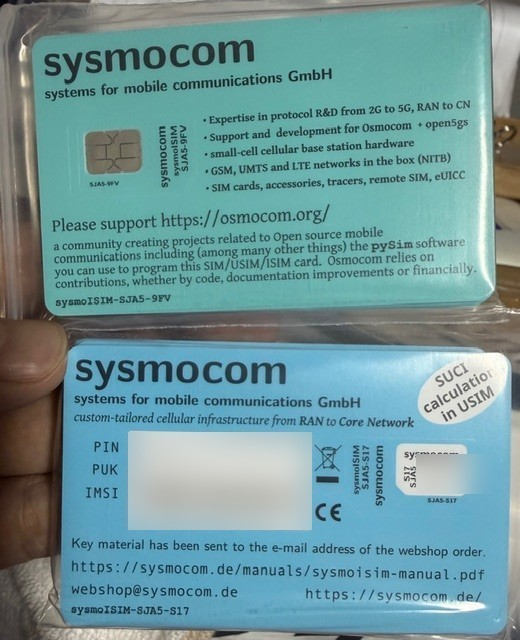
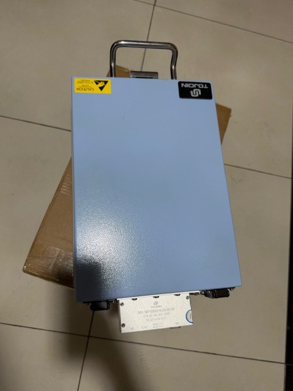
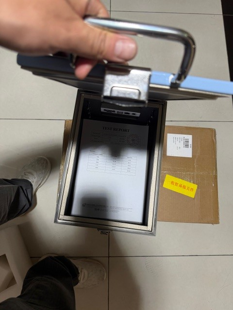
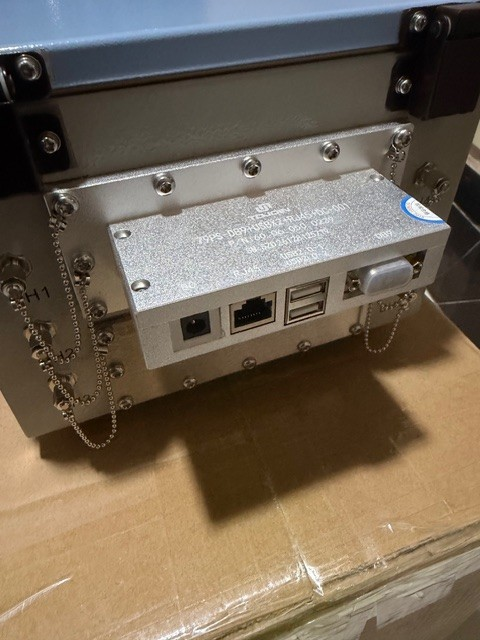
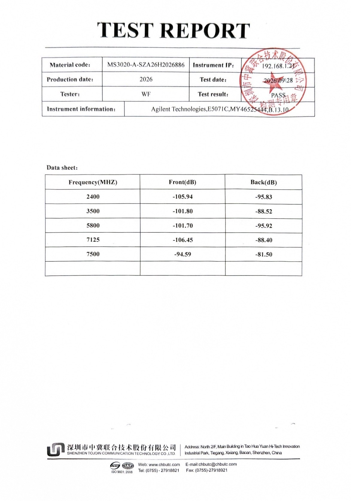

# 로컬 5G 망 구축하기 — 해커를 위한 이동통신 실무서

<details>
<summary><b>English</b> — click to expand</summary>

## Building a Local 5G Network — A Hacker's Field Guide to Mobile Networks

> **📕 [Download the PDF (A4, 181 pages, Korean)](https://github.com/AmesianX/local-5g-handbook/releases/latest/download/local-5g-handbook-ko.pdf)** · [All editions](https://github.com/AmesianX/local-5g-handbook/releases)

One Linux box, one software-defined radio, one 5G modem and a SIM card whose secret key we wrote ourselves. This is the record of how we built a complete 5G mobile network in a single room, from the radio up through the core and the phone system, until a real Galaxy phone rang with a number issued by our own network.

> **Phreaking was the hacker's playground of the 1970s. Today, it's building your own local 5G network.**

*The book is written in Korean. This page introduces it in English.*

---

## A carrier of your own, in your own room

Most of us grew up believing that a mobile network is something only a handful of licensed carriers are allowed to run. That isn't wrong, but it helps to ask *why* spectrum has owners in the first place. Radio waves radiated into the open interfere with one another, degrade public services and trample on the carriers' business, so the airwaves can't be a free-for-all. Which raises an interesting question: what about a closed space from which not a single milliwatt escapes? If there is no one to interfere with, could we stand up a base station of our own and start signing up subscribers?

Picture it. We flash a blank SIM with a 128-bit key of our choosing, add one line with an IMSI and a phone number to our subscriber database, and slide the card into a Galaxy phone. The status bar lights up with `5G` and `HD`. We dial the number and the phone rings; we send a text and the bubble appears. And everything in between — the cryptographic handshake in which the phone proves who it is, the message that hands it an IP address, the SIP that sets up the call, the RTP packets carrying a voice — flows through our own Linux box, so we can follow, in Wireshark, a conversation the carriers have never once let us see.

Push the idea a little further. The network's only way out to the internet is the Linux box's default route. Carry that box and the radio to a mountain hut, a ship at sea, or a village whose towers have fallen in an earthquake, plug a satellite terminal into that route, and *our* cell comes alive right there: people take the phones out of their pockets, insert a SIM we burned for them, and call each other and get online. A network that does everything a carrier does, without a carrier, that we can carry in our hands. This is not just a daydream, either. Japan has licensed exactly this kind of network to non-carriers since 2019 under the name **Local 5G**, Korea since 2021 as **e-Um 5G**, and those networks are built from the very same pieces this book assembles.

## It started at 2600 Hz

In the 1970s there were people in the United States who called themselves **phone phreaks**. Long-distance switches of the day signalled to one another over the very same line that carried your voice, so if you blew a 2600 Hz tone into the handset, the switch concluded the line was idle and sat waiting for its next command. A toy whistle given away in boxes of breakfast cereal produced exactly that pitch, and a device that generated the whole set of tones at the push of a button became known as the **blue box**. A college student named Steve Wozniak redesigned the blue box with digital circuitry, and his friend Steve Jobs sold them. Jobs later said that without the blue box there would have been no Apple — that it was where they first learned a giant system could be moved by a box that fit in your palm.

For the half-century that followed, mobile networks became the most closed territory a hacker could face. The baseband runs its own firmware beneath the operating system, base stations sit on rooftops, and the core lives in refrigerator-sized racks inside the carrier's exchange; all we ever got to see were a few signal bars on the status bar. Then, quietly, the work inside those refrigerators turned into Linux processes calling one another over HTTP/2. Open-source cores and base stations matured to the point where real phones can attach to them, and programmable SIM cards became something an individual can simply order.

The phreaks found ways to fool the switch. **Now we get to own the switch.** Just as hackers back then were hooked on peering into the guts of a continent-spanning network with nothing but a whistle, the engineer of our era has inherited that same thrill, and it takes the form of **building a 5G network in your own room.** The difference is that this time we aren't fooling anyone's network — we are building our own from end to end. Which is exactly why there is no need to hide it, and why we can publish it as a book and enjoy it together.

## But what about the radio? Experiments A and B

The dream is big, but the first step has to be careful. A radio experiment carries risk in two directions: outward, we must never disturb anyone else's communications; inward, we must not burn our own equipment. The whole book is built on two experiments that avoid both.

**Experiment A — anyone, right now.** Instead of antennas, connect the software radio playing the base station (a B210) and the 5G modem module playing the phone **directly with coaxial cable, with an attenuator in between.** The signal travels only inside a metal tube instead of through the air, so nothing is radiated, and you can start on your desk without an expensive shielded enclosure. Registration and authentication, data and throughput, and even calls and texts placed by our own test tools — nearly the whole network is built and measured with this one setup. It is the idea this book cherishes most: rather than trapping radio waves, we never create them in the first place, and the modem under test doubles as the instrument that measures the network.

**Experiment B — with a real phone.** What goes inside the shield box — a metal enclosure radio waves cannot escape — is **the phone, not the B210.** The B210 stays outside and its signal is fed through the wall of the box over coax, becoming radio only at a small antenna on the inside. The phone is the side whose antenna can't be removed, so the phone is what we enclose. Do it the other way round and the phone, left outside, hears a commercial cell thousands of times stronger and never even sees ours. You need to get hold of a shield box, so the bar is higher, but in return you get to experiment with the very phone in your pocket.

> ⚠️ **Connect without an attenuator and you will burn your gear.** When a phone first raises its hand to the network it can shout at up to +23 dBm, while the B210's receiver is only good for about 0 dBm. A 40 dB attenuator brings that shout down to −17 dBm. And don't drop the attenuator just because you're inside the shield box: a hand's width of air barely takes anything off the signal. Section 0.7 has the full rules.

## What we actually achieved

Every number in this book was measured in our own lab. Throughout the text, calculated values are marked **[estimate]**, measured values **[measured]**, and anything still unconfirmed **[needs verification]**.

| | |
|---|---|
| Radio | 5G NR SA, band n78 TDD, centre 3350.01 MHz (40 MHz clear of commercial allocations), 20 MHz |
| RAN · Core | srsRAN Project + B210 · Open5GS 5GC + Kamailio IMS + PyHSS |
| Experiment A | Quectel RM520N-GL modem + self-programmed sysmoISIM-SJA5, direct coax + 40 dB attenuator |
| Experiment B | Real Galaxy S22+ handset inside a TOJOIN MS3020-A shield box |
| Throughput (A) | 55 Mbps down / 11 Mbps up |
| Round-trip latency | A: 38 ms, B: 25–31 ms (UE → UPF) |
| Calls & messaging | VoNR voice calls, SMS, MMS, video call setup (on a real phone in experiment B) |
| Shield-box leakage | Below detection limit |

## Why we are sharing this

The phreaks traded what they discovered through newsletters and magazines, and we are doing the same with the road we stumbled along. Mobile networking has long been locked behind thousands of pages of standards and the doors of the carriers, and a curious engineer diving in alone can easily be worn out by decibels, channel numbers and SIM keys before ever bringing up a first cell. That was us, too. We lost half a day to a single USB 2.0 cable, chased 30 dB around the wrong corner of the system because we misread one number on an engineering screen, and watched a call setup that had worked between our scripts for four months get rejected by a real phone on its very first try.

So this book does not lay out theory first, textbook-style. Knowledge appears exactly where building experiment A gets stuck, as the answer to that particular block, and the twenty-four times we actually got stuck are preserved in a casebook — the symptom, the wrong hypotheses, the one decisive log line, and the fix. We want the next person not to lose the same hours in the same places. By the time you close the book, you should be able to explain what happens behind those signal bars not from someone else's diagram but from the logs of a network you brought up with your own hands.

## The hardware in our lab

<table>
<tr>
<td align="center" valign="top"><a href="images/photos/sim-cards.jpg"></a><br><sub>sysmoISIM-SJA5 cards (9FV and S17). PIN, PUK and IMSI blurred</sub></td>
<td align="center" valign="top"><a href="images/photos/shieldbox.jpg"></a><br><sub>The shield box, TOJOIN MS3020-A</sub></td>
<td align="center" valign="top"><a href="images/photos/shieldbox-open.jpg"></a><br><sub>Lid open. The phone goes in here</sub></td>
</tr>
<tr>
<td align="center" valign="top"><a href="images/photos/shieldbox-filter-panel.jpg"></a><br><sub>Filter panel: RJ45, USB and power feed-throughs, SMA ports</sub></td>
<td align="center" valign="top"><a href="images/photos/shieldbox-test-report.jpg"></a><br><sub>Factory test report: −101.8 dB at 3.5 GHz</sub></td>
</tr>
</table>

<sub>Click a photo to see it full size.</sub>

## Who it's for

Hackers and engineers who are at home with networking and Linux but have never studied electronics or mobile communications. If you can open a capture in Wireshark and spin up a container, you are ready; it's fine if you've never heard of a decibel or OFDM. Unfamiliar ideas are explained through things you already know — port numbers, relative paths, floating-point epsilon.

## Contents

<table>
<tr><td width="10%" nowrap></td><td width="34%"><b>Preface · Ch. 0</b></td><td width="56%">A network of your own: why build it, experiments A and B, the rules that keep your gear alive</td></tr>
<tr><td nowrap>🅰️</td><td><b>Experiment A — build the network over coax</b></td><td>Parts I–IV. B210 and 5G modem wired directly through attenuators. Nothing is radiated into the air, so no shield box is needed. Anyone, right now</td></tr>
<tr><td nowrap><b>Part I</b></td><td>Before the gear arrives</td><td>1 Radio waves and frequency · 2 SDR and the B210 · 3 Mobile networks at a glance</td></tr>
<tr><td nowrap><b>Part II</b></td><td>First signal</td><td>4 Building the lab · 5 OFDM and the 5G NR physical layer · 6 The base station</td></tr>
<tr><td nowrap><b>Part III</b></td><td>First subscriber</td><td>7 What a SIM really is · 8 Modems and AT commands · 9 The 5G core and SBI · 10 Identity and authentication</td></tr>
<tr><td nowrap><b>Part IV</b></td><td>The network walks</td><td>11 Sessions and IP · 12 QMI and the data path · 13 Voice and text (IMS) · 14 The engineering screen, dissected · 15 Test procedure and measurement</td></tr>
<tr><td nowrap>🅱️</td><td><b>Experiment B — a real phone in a shield box</b></td><td>Part V. Keep the network from A, swap the UE for a real phone</td></tr>
<tr><td nowrap><b>Part V</b></td><td>Experiment B</td><td>16 A real phone inside the shield box</td></tr>
<tr><td nowrap></td><td><b>Beyond</b></td><td>The casebook for when you get stuck, and background that makes you stronger</td></tr>
<tr><td nowrap><b>Part VI</b></td><td>When you fall</td><td>17 Casebook: the twenty-four times we got stuck</td></tr>
<tr><td nowrap><b>Part VII</b></td><td>Going deeper</td><td>18 History of the modem and dial-up, dissected · 19 The entire AT command system · 20 Attack surface and trust boundaries</td></tr>
<tr><td nowrap><b>Appendices</b></td><td></td><td>A Glossary · B Command reference · C Configuration file map · D Radio and legal notice</td></tr>
</table>

## Safety and the law

Every experiment in this book assumes **nothing is radiated into the open air**: in experiment A the signal stays inside coaxial cable, in experiment B inside a shield box. Mobile spectrum requires a licence in every country, so transmitting over the air without one is against the law — and the 3.6 GHz values common in example configs sit right in the middle of commercial allocations, so never copy them as-is. PLMN 001/01 is the code the international standards set aside for testing. Appendix D collects where the law draws its lines; please read it before you power anything on.

Real values for subscriber keys (Ki, OPc), card admin keys (ADM) and PIN/PUK never appear in the book; they are all replaced by placeholders such as `<KI>`, `<OPC>` and `<ADM1>`.

## Repository layout

| Path | Contents |
|---|---|
| `00-머리말.md`, `00a-…`, `01-…` – `20-…`, `부록A–D` | The book, in Markdown |
| `reader.html` | Single-page reader with contents, search and reading position; download and open in a browser |
| `images/` | Figures and real-phone screenshots |
| `tools/make_pdf.py`, `tools/build_reader.py` | Build the PDF and the reader; the PDF build verifies every table-of-contents page number against the printed pages |
| `tools/edit_guard.py` | Checks that an edited manuscript left code, numbers and cross-references untouched |
| `tools/acronym_audit.py`, `tools/gloss_audit.py`, `tools/landing_audit.py` | Acronym, term-definition and section-ending audits |
| `tools/ims_call.py`, `tools/milenage.py` | Test tools used in the book (keys are placeholders) |

```bash
python3 tools/build_reader.py   # reader.html
python3 tools/make_pdf.py       # 로컬5G망구축하기.pdf (needs Playwright Chromium and poppler-utils)
```

## License

MIT License. © AmesianX. All measurements and logs in the text come from this lab.

</details>

> **📕 [PDF 내려받기 (A4, 181쪽)](https://github.com/AmesianX/local-5g-handbook/releases/latest/download/local-5g-handbook-ko.pdf)** · [모든 판 보기](https://github.com/AmesianX/local-5g-handbook/releases)

리눅스 한 대, 소프트웨어 라디오 하나, 5G 모뎀 하나, 그리고 비밀 키를 직접 써 넣은 SIM 카드 한 장으로 우리 방에 5G 이동통신망을 세우고, 실물 갤럭시 폰에 우리 망의 번호로 전화를 걸어 벨을 울리기까지의 기록이다.

> **70 년대 해커들에게 프리킹이 있었다면, 지금 우리에게는 로컬 5G 가 있다.**

---

## 내 방에 통신사가 하나 생긴다

우리는 그동안 이동통신망을 나라가 주파수를 내준 몇몇 통신사만 운영할 수 있는 세계라고 여기며 살아왔다. 그 생각이 아주 틀린 것도 아니지만, 주파수에 주인을 정해 둔 이유를 한 걸음만 들어가 보면 이야기가 조금 달라진다. 공중으로 퍼진 전파가 서로 간섭하면 공공 서비스가 흔들리고 통신사의 영업이 침해되니 아무나 같은 주파수를 쓰게 둘 수 없었던 것인데, 그렇다면 전파가 밖으로 한 줌도 새어 나가지 않는 닫힌 공간 안에서라면 어떨까. 간섭할 상대가 없는 그 안에서는 우리도 기지국을 세우고 가입자를 받아 볼 수 있지 않을까.

자, 이런 장면을 한번 떠올려 보자. 빈 SIM 카드에 우리가 정한 128 비트 비밀 키를 써 넣고, 가입자 데이터베이스에 IMSI 와 전화번호를 한 줄 등록한 다음, 그 카드를 갤럭시 폰에 꽂는다. 전원을 켜면 상태바에 `5G` 와 `HD` 가 뜨고, 그 번호로 전화를 걸면 벨이 울리고, 문자를 보내면 말풍선이 쌓인다. 그 사이에 오가는 모든 것, 그러니까 폰이 "나는 이 가입자다"를 증명하는 암호 왕복부터 IP 주소를 내주는 메시지, 전화를 잇는 SIP, 목소리가 실린 RTP 패킷까지가 전부 우리 리눅스 박스를 지나가니, 통신사가 한 번도 보여 준 적 없는 대화를 와이어샤크로 처음부터 끝까지 따라갈 수 있게 된다.

상상을 조금 더 밀어 보면, 이 망이 인터넷으로 나가는 출구는 리눅스 박스의 기본 경로 하나뿐이다. 그러니 이 박스와 라디오를 들고 기지국이 닿지 않는 산장이나 바다 위의 배, 기지국이 무너진 마을로 가서 위성 단말 하나를 출구에 물리면 그 자리에 **우리 셀**이 서고, 사람들은 주머니 속 폰에 우리가 구워 준 SIM 을 꽂아 서로 전화하고 인터넷을 쓰게 된다. 통신사 없이도 통신사가 하는 일을 해내는 망을 우리 손으로 들고 다니는 셈이다. 실제로 일본은 2019 년부터 **로컬 5G**, 한국은 2021 년부터 **이음 5G** 라는 이름으로 통신사가 아닌 사업자에게 이런 망을 허가하고 있고, 그 망도 결국 이 책과 똑같은 조각들로 이루어져 있다.

## 2600 Hz 에서 시작된 이야기

1970 년대 미국에는 스스로를 **폰 프리커**(phone phreaker)라 부르던 사람들이 있었다. 그 무렵 장거리 교환기는 음성이 지나는 바로 그 회선으로 서로 신호를 주고받았기 때문에, 수화기에 2600 Hz 톤을 불어 넣으면 교환기는 회선이 비었다고 믿고 다음 명령을 기다렸다. 시리얼 상자에 경품으로 들어 있던 장난감 호루라기가 정확히 그 소리를 냈고, 그 톤들을 버튼 하나로 내 주는 상자를 사람들은 **블루박스**라고 불렀다. 대학생이던 스티브 워즈니악이 그 상자를 디지털 회로로 다시 설계했고 친구 스티브 잡스가 그것을 내다 팔았는데, 잡스는 훗날 블루박스가 없었다면 애플도 없었을 것이라고 말했다. 거대한 시스템을 손바닥만 한 상자 하나로 움직일 수 있다는 것을 거기서 처음 배웠다는 뜻이었다.

그 뒤 반세기 동안 이동통신은 해커에게 가장 닫힌 영역이 되었다. 통신 칩은 운영체제 아래에서 자기만의 펌웨어로 돌고, 기지국은 옥상에, 코어망은 통신사 국사의 냉장고만 한 장비 속에 들어가 있어서, 우리에게 보이는 것이라고는 상태바의 안테나 막대 몇 개뿐이었다. 그런데 그 냉장고 속 일이 어느새 HTTP/2 로 서로를 부르는 리눅스 프로세스로 옮겨 왔고, 오픈소스 코어망과 기지국은 실물 폰을 붙일 만큼 자랐으며, 비밀 키를 직접 써 넣을 수 있는 SIM 카드도 이제 개인이 주문해서 받을 수 있게 되었다.

프리커들이 교환기를 속일 방법을 찾았다면, 이제 우리는 교환기를 직접 가져 볼 수 있다. 그 시절 해커들이 휘파람 하나로 대륙 너머의 교환기를 움직이며 거대한 망의 속을 들여다보는 재미에 빠졌듯이, 지금 시대의 엔지니어에게 그 자리를 이어받는 놀이가 바로 **내 방에 5G 망을 세우는 일**이다. 다만 이번에는 남의 망을 속이는 것이 아니라 우리 망을 처음부터 끝까지 우리 손으로 짓는다는 점이 다르고, 그래서 몰래 할 이유도 없이 이렇게 책으로 내놓고 함께 즐길 수 있다.

## 그럼 전파는 어떻게 하나: 실험 A 와 실험 B

꿈은 크지만 첫걸음은 조심스러워야 한다. 전파 실험에는 위험이 두 방향으로 있어서, 바깥으로는 남의 통신을 방해하지 않아야 하고 안쪽으로는 우리 장비를 태우지 않아야 한다. 이 책은 그 두 가지를 모두 피하는 두 실험을 척추로 삼아 이야기를 끌고 간다.

**실험 A — 누구나, 지금 바로.** 기지국 역할의 소프트웨어 라디오(B210)와 단말 역할의 5G 모뎀 모듈을 안테나 대신 **동축 케이블로 직접 잇고, 그 사이에 감쇠기를 끼운다.** 전파가 공기 대신 금속 관 속으로만 흐르니 공중으로 나가는 것이 없고, 값비싼 차폐함 없이도 책상 위에서 바로 시작할 수 있다. 등록과 인증, 데이터와 처리량, 시험 도구로 거는 전화와 문자까지 망의 거의 전부를 이 실험 하나로 세우고 잰다. 전파를 가두는 대신 애초에 만들지 않는다는 점에서, 그리고 시험 대상인 모뎀이 그대로 망을 재는 계측기가 된다는 점에서 이 책이 가장 아끼는 발상이다.

**실험 B — 진짜 전화기로.** 전파가 새지 않는 금속 상자인 **차폐함에 넣는 것은 B210 이 아니라 폰이다.** B210 은 상자 밖에 두고 그 신호를 동축 케이블로 상자 벽 너머까지 들여보내, 상자 안쪽의 작은 안테나에서만 전파가 되게 한다. 안테나를 떼어 낼 수 없는 쪽이 폰이니 폰을 가두는 것이고, 거꾸로 B210 을 상자에 넣으면 밖에 둔 폰은 수천 배 센 상용 기지국 신호를 듣느라 우리 셀을 보지 못한다. 차폐함을 따로 구해야 해서 문턱은 높지만, 그 대가로 우리 주머니 속 그 전화기로 실험할 수 있다.

> ⚠️ **감쇠기 없이 직결하면 장비가 탄다.** 단말은 망에 처음 손을 들 때 최대 +23 dBm 으로 외치는데, B210 수신단이 견디는 한계는 0 dBm 근처다. 40 dB 감쇠기를 끼우면 그 외침이 −17 dBm 으로 줄어든다. 차폐함 안이라고 감쇠기를 빼도 안 되는데, 한 뼘 거리의 공기는 신호를 거의 깎아 주지 않기 때문이다. 자세한 규칙은 0.7 절에 있다.

## 우리가 실제로 해낸 것

이 책의 숫자는 전부 우리 실험실에서 직접 잰 것이다. 계산으로 얻은 값은 **[추정]**, 잰 값은 **[측정]**, 아직 확인하지 못한 것은 **[검증 필요]** 로 본문에서 구분해 두었다.

| 항목 | 값 |
|---|---|
| 무선 | 5G NR SA, n78 TDD, 중심 3350.01 MHz (상용 할당과 40 MHz 이격), 20 MHz |
| 기지국 · 코어 | srsRAN Project + B210 · Open5GS 5GC + Kamailio IMS + PyHSS |
| 실험 A | Quectel RM520N-GL 모뎀 + 직접 구운 sysmoISIM-SJA5, 동축 직결 + 40 dB 감쇠기 |
| 실험 B | 갤럭시 S22+ 실물 폰, 차폐함 TOJOIN MS3020-A |
| 처리량 (실험 A) | 하향 55 / 상향 11 Mbps |
| 왕복 지연 | 실험 A 38 ms, 실험 B 25~31 ms (단말 → UPF) |
| 전화 · 문자 | VoNR 음성통화, SMS, MMS, 영상통화 연결 (실험 B 는 실물 폰으로) |
| 차폐함 누설 | 검출 한계 아래 |

## 이 정보를 나누는 이유

프리커들이 소식지와 잡지로 자기가 알아낸 것을 서로 나눴듯이, 우리도 우리가 헤맨 길을 그대로 내놓는다. 이동통신은 오랫동안 표준 문서 수천 쪽과 통신사의 문 너머에 갇혀 있던 지식이라, 호기심 많은 엔지니어가 혼자 뛰어들면 첫 셀을 띄우기도 전에 데시벨과 주파수 번호와 SIM 키 앞에서 지쳐 버리기 쉽다. 우리도 그랬다. USB 2.0 케이블 하나 때문에 반나절을 날렸고, 엔지니어 모드의 숫자 하나를 잘못 읽어 30 dB 를 엉뚱한 데서 찾아 헤맸고, 넉 달 동안 스크립트끼리는 잘 통하던 전화를 실물 폰은 첫 통화에서 거절했다.

그래서 이 책은 교과서처럼 지식을 먼저 늘어놓지 않는다. 실험 A 를 세우다가 막히는 바로 그 자리에서 그 막힘을 푸는 답으로 지식을 꺼내고, 우리가 실제로 막혔던 스물네 번은 증상과 틀린 가설과 결정적인 로그 한 줄과 조치까지 사례집에 그대로 남겼다. 다음 사람이 같은 자리에서 같은 시간을 버리지 않기를 바라서다. 이 책을 덮을 즈음에는 상태바의 안테나 막대 뒤에서 무슨 일이 일어나는지를, 남이 그려 준 그림이 아니라 우리 손으로 띄운 망의 로그로 설명할 수 있게 될 것이다.

## 우리 실험실의 장비

<table>
<tr>
<td align="center" valign="top"><a href="images/photos/sim-cards.jpg"></a><br><sub>sysmoISIM-SJA5 카드 두 종(9FV·S17). PIN·PUK·IMSI 는 가렸다</sub></td>
<td align="center" valign="top"><a href="images/photos/shieldbox.jpg"></a><br><sub>차폐함 TOJOIN MS3020-A</sub></td>
<td align="center" valign="top"><a href="images/photos/shieldbox-open.jpg"></a><br><sub>뚜껑을 연 차폐함. 이 안에 폰이 들어간다</sub></td>
</tr>
<tr>
<td align="center" valign="top"><a href="images/photos/shieldbox-filter-panel.jpg"></a><br><sub>필터 패널: RJ45·USB·전원 관통과 SMA 단자</sub></td>
<td align="center" valign="top"><a href="images/photos/shieldbox-test-report.jpg"></a><br><sub>공장 시험 성적서: 3.5 GHz 에서 −101.8 dB</sub></td>
</tr>
</table>

<sub>사진을 누르면 크게 볼 수 있다.</sub>

## 이런 사람을 위해 썼다

네트워크와 리눅스는 손에 익었지만 전자공학과 이동통신은 한 번도 배워 본 적 없는 해커와 엔지니어를 위해 썼다. 와이어샤크로 패킷을 열어 보고 컨테이너를 띄울 줄 알면 출발 준비는 된 셈이고, 데시벨이나 OFDM 은 처음 들어도 괜찮다. 그런 낯선 개념은 포트 번호, 상대 경로, 부동소수점 엡실론처럼 우리가 이미 아는 것에 빗대어 풀어 두었다.

## 책의 구성

<table>
<tr><td width="10%" nowrap></td><td width="34%"><b>머리말 · 0 장</b></td><td width="56%">나만의 이동통신망: 왜 세우는가, 실험 A 와 B, 장비를 태우지 않는 규칙</td></tr>
<tr><td nowrap>🅰️</td><td><b>실험 A — 동축 케이블로 망을 세운다</b></td><td>Part I~IV. B210 과 5G 모뎀을 감쇠기를 끼운 동축으로 직결. 전파가 공중으로 방사되지 않아 차폐함 없이도 실험할 수 있다. 누구나, 지금 바로</td></tr>
<tr><td nowrap><b>Part I</b></td><td>장비가 오기 전에</td><td>1 전파와 주파수 · 2 SDR 과 B210 · 3 이동통신망 한눈에 보기</td></tr>
<tr><td nowrap><b>Part II</b></td><td>첫 전파</td><td>4 실험실 구성 · 5 OFDM 과 5G NR 물리 계층 · 6 기지국</td></tr>
<tr><td nowrap><b>Part III</b></td><td>첫 가입자</td><td>7 SIM 카드의 정체 · 8 모뎀과 AT 명령 · 9 5G 코어와 SBI · 10 가입자 식별과 인증</td></tr>
<tr><td nowrap><b>Part IV</b></td><td>망이 걷는다</td><td>11 세션과 IP 할당 · 12 QMI 와 데이터 경로 · 13 음성과 문자(IMS) · 14 엔지니어 모드 완전 해부 · 15 시험 절차와 측정</td></tr>
<tr><td nowrap>🅱️</td><td><b>실험 B — 차폐함 안의 진짜 폰</b></td><td>Part V. 실험 A 로 세운 망을 그대로 두고 단말만 실물 폰으로</td></tr>
<tr><td nowrap><b>Part V</b></td><td>실험 B</td><td>16 차폐함 안에 진짜 폰을 올린다</td></tr>
<tr><td nowrap></td><td><b>그다음</b></td><td>막혔을 때 펴 보는 사례집과, 알면 더 강해지는 배경</td></tr>
<tr><td nowrap><b>Part VI</b></td><td>넘어졌을 때</td><td>17 사례집: 우리가 막혔던 스물네 번</td></tr>
<tr><td nowrap><b>Part VII</b></td><td>더 깊이</td><td>18 모뎀의 역사와 다이얼업 해부 · 19 AT 명령 체계 전부 · 20 공격 표면과 신뢰 경계</td></tr>
<tr><td nowrap><b>부록</b></td><td></td><td>A 용어집 · B 명령 레퍼런스 · C 설정 파일 맵 · D 전파와 법규 고지</td></tr>
</table>

처음 읽을 때는 순서대로 따라오는 편이 좋다. 이미 특정 문제를 쫓고 있다면 17 장 사례집에서 증상을 찾아 거기서 가리키는 장으로 거슬러 올라가도 된다.

## 안전과 법규

이 책의 모든 실험은 **공중으로 전파를 내보내지 않는 것**을 전제로 한다. 실험 A 는 동축 케이블 안에서, 실험 B 는 차폐함 안에서만 전파가 오간다. 이동통신 주파수는 나라마다 허가 대상이어서 허가 없이 공중으로 송신하면 법을 어기게 되고, 예제 설정에서 흔히 보이는 3.6 GHz 대 값은 상용 사업자의 한가운데이니 그대로 복사해서는 안 된다. PLMN 001/01 은 국제 표준이 시험용으로 비워 둔 번호다. 법이 어디에 선을 긋는지는 부록 D 에 모아 두었으니 장비를 켜기 전에 꼭 먼저 읽어 주기 바란다.

책에는 가입자 인증 키(Ki, OPc), 카드 관리 키(ADM), PIN/PUK 의 실제 값을 넣지 않았고, 모두 `<KI>`, `<OPC>`, `<ADM1>` 같은 자리표시자로 바꿔 두었다.

## 저장소 안내

| 파일 | 내용 |
|---|---|
| `00-머리말.md`, `00a-…`, `01-…` ~ `20-…`, `부록A~D` | 책 본문 (마크다운) |
| `reader.html` | 목차·검색·읽던 위치를 갖춘 한 페이지 읽기판. 내려받아 브라우저로 연다 |
| `images/` | 본문 그림과 실물 폰 화면 |
| `tools/make_pdf.py`, `tools/build_reader.py` | PDF 와 읽기판 빌드. PDF 는 차례가 가리키는 쪽을 스스로 대조한다 |
| `tools/edit_guard.py` | 다듬은 원고가 코드·숫자·참조를 바꾸지 않았는지 원본과 대조 |
| `tools/acronym_audit.py`, `tools/gloss_audit.py`, `tools/landing_audit.py` | 약어·용어 풀이·절 마무리 점검 |
| `tools/ims_call.py`, `tools/milenage.py` | 책에 나오는 시험 도구 (키는 자리표시자) |

```bash
python3 tools/build_reader.py   # reader.html
python3 tools/make_pdf.py       # 로컬5G망구축하기.pdf (Playwright Chromium, poppler-utils 필요)
```

## 라이선스

MIT License. © AmesianX. 본문의 측정값과 로그는 모두 이 실험실에서 얻은 것이다.
